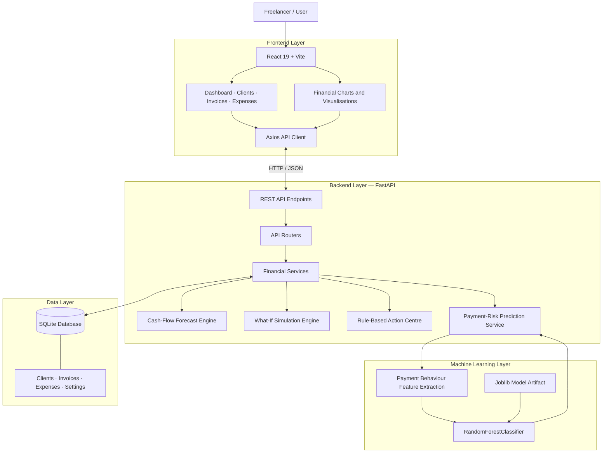

# 💜 SoloLedger

### Your personal financial co-pilot for freelancing.

**Manage smarter. Grow faster. Stay financially prepared.**

SoloLedger is a freelancer-focused financial management and cash-flow intelligence platform that brings clients, invoices, expenses, financial forecasting and payment-risk insights together in one place.

Instead of simply tracking past transactions, SoloLedger helps freelancers understand their current financial position, anticipate potential cash-flow problems and make more informed business decisions.

---

<p align="center">


</p>

---

## 📌 Table of Contents

- [The Problem](#-the-problem)
- [Our Solution](#-our-solution)
- [Key Features](#-key-features)
- [System Architecture](#-system-architecture)
- [Financial Intelligence](#-financial-intelligence)
- [Machine Learning](#-machine-learning-payment-risk)
- [Technology Stack](#-technology-stack)
- [Getting Started](#-getting-started)
- [API Reference](#-api-reference)
- [Limitations](#-limitations)

---

## 🎯 The Problem

Freelancers often manage their finances using disconnected spreadsheets, messaging apps and manual records.

This creates several challenges:

- **Irregular income:** Unpredictable client payments make financial planning difficult.
- **Delayed payments:** Freelancers struggle to track overdue invoices and identify unreliable payment patterns.
- **Expense visibility:** Business expenses are scattered across different payment methods and records.
- **Cash-flow uncertainty:** It is difficult to determine whether upcoming income will cover future expenses.
- **Reactive decisions:** Financial problems are often noticed only after they affect the business.

Freelancers need more than an expense tracker. They need a way to understand and anticipate their financial position.

## 💡 Our Solution

SoloLedger acts as a lightweight financial co-pilot for independent professionals.

It combines financial record management, deterministic financial analysis, cash-flow forecasting and a machine-learning-based payment-risk feature.

With SoloLedger, freelancers can:

- Track clients, invoices and payments.
- Monitor business expenses.
- Understand income, expenses and available cash.
- Forecast their financial position for the next 30, 60 or 90 days.
- Simulate hypothetical financial scenarios.
- Identify clients with potential payment delays.
- Receive prioritised financial alerts.

---

## ✨ Key Features

### 1. 📊 Smart Financial Dashboard

A consolidated view of business finances.

- Total income and expenses.
- Net profit.
- Pending and overdue payments.
- Available cash balance.
- Monthly financial performance visualisations.
- Expense category breakdown.

### 2. 👥 Client Management

- Add, view, update and delete clients.
- Maintain client contact information.
- View invoices associated with clients.
- Access individual client payment-risk predictions.

### 3. 🧾 Invoice Management

- Create and manage invoices.
- Associate invoices with clients.
- Track pending, paid and overdue statuses.
- Mark invoices as paid.
- Automatically identify overdue invoices based on due dates.

### 4. 💸 Expense Management

- Record business expenses.
- Categorise expenses.
- Track payment methods such as cash, UPI, card and bank transfer.
- Mark expenses as paid or upcoming.
- Filter expenses by category and date.

### 5. 📈 Predictive Cash-Flow Forecasting

Understand your projected financial position before problems arise.

- 30-day, 60-day and 90-day forecasts.
- Expected incoming payments.
- Upcoming scheduled expenses where supported by the data.
- Projected closing cash balance.
- Identification of potential negative cash-flow periods.

### 6. 🔮 What-If Financial Simulator

Test hypothetical financial scenarios without changing actual financial records.

Simulate:

- Delayed client payments.
- Unexpected expenses.
- Additional hypothetical income.

Compare baseline and simulated cash-flow projections to understand how different situations could affect your finances.

### 7. 🤖 ML-Based Payment Risk Prediction

A client-level payment-risk prediction feature powered by a RandomForestClassifier.

- Analyses historical payment behaviour.
- Uses previous payment delays and invoice amounts as input features.
- Classifies predicted payment risk into Low, Medium and High categories.
- Handles insufficient payment history without inventing a prediction.

**Note:** The current model is trained on synthetic data. Its predictions are indicative and should not be treated as authoritative financial assessments.

### 8. 🚨 Financial Action Centre

A centralised place for important financial alerts.

- Overdue invoice alerts.
- Pending payment insights.
- Low cash-balance warnings.
- Negative cash-flow risk alerts.
- Expense trend insights.
- Priority-based alert organisation.
- Suggested actions to help freelancers decide what to address first.

---

## 🏗️ System Architecture

SoloLedger follows a frontend-backend architecture. The React frontend communicates with the FastAPI backend through REST APIs. The backend handles business logic, financial calculations, database operations and machine-learning predictions.

### Architecture Diagram



### How the system works

| Layer | Responsibility |
|---|---|
| Frontend | Displays dashboards, financial records, charts and predictions. |
| API layer | Handles HTTP requests and responses through FastAPI. |
| Business logic | Performs financial calculations, forecasting and scenario analysis. |
| ML layer | Generates client payment-risk predictions. |
| Database | Stores clients, invoices, expenses and settings. |

**Two complementary intelligence approaches:**

- **Rule-based intelligence:** Cash-flow forecasting, scenario simulation and prioritised financial alerts.
- **Machine learning:** Random Forest-based client payment-risk prediction.

This combination allows SoloLedger to provide explainable financial calculations alongside a data-driven predictive feature.

---

## 🧠 Financial Intelligence

SoloLedger goes beyond basic financial record management through four core intelligence modules.

| Module | Purpose | Approach |
|---|---|---|
| Smart Dashboard | Understand current financial position | Financial calculations |
| Cash-Flow Forecast | Estimate future cash position | Rule-based forecasting |
| What-If Simulator | Evaluate hypothetical financial scenarios | Scenario-based calculations |
| Financial Action Centre | Identify and prioritise financial risks | Rule-based analysis |

The platform is designed to help freelancers move from reactive financial tracking to proactive financial planning.

---

## 🤖 Machine Learning – Payment Risk

The payment-risk feature uses a **RandomForestClassifier** to estimate the likelihood of delayed client payments.

### Model inputs

The model uses features derived from historical paid invoices, including:

- Previous invoice count.
- Previous late-payment count.
- Historical late-payment percentage.
- Average payment delay.
- Maximum payment delay.
- Average historical invoice amount.
- Current invoice amount.

### Training approach

- Synthetic invoice-payment records are used to generate training data.
- A fixed random seed ensures reproducibility.
- The model is evaluated using a train/test split.
- The trained model is saved using Joblib.
- Historical client data is used to calculate prediction features.

### Prediction behaviour

| Risk category | Probability |
|---|---|
| Low | Below 30% |
| Medium | 30% to below 60% |
| High | 60% and above |
| Unknown | Insufficient payment history |

Clients with fewer than three previous paid invoices are treated as having insufficient history. No probability is displayed when there is no usable history.

**Important:** Synthetic training data does not establish real-world predictive accuracy. The model needs validation against real, appropriately labelled payment histories before its predictions can be relied upon.

---

## 🛠️ Technology Stack

### Backend

| Technology | Usage |
|---|---|
| Python | Core backend language |
| FastAPI | REST API framework |
| Uvicorn | ASGI server |
| SQLite | Relational database |
| Pydantic | Request and response validation |
| scikit-learn | Machine learning |
| Joblib | Model serialisation |

### Frontend

| Technology | Usage |
|---|---|
| React 19 | User interface |
| Vite | Frontend build tooling |
| React Router | Navigation |
| Tailwind CSS | Styling |
| Recharts | Data visualisation |
| Axios | API communication |

### Data and Financial Accuracy

- SQLite stores the application's financial records.
- Monetary values are stored as integer cents to avoid floating-point rounding errors.
- Financial calculations use actual stored records rather than hardcoded dashboard values.

---

## 🚀 Getting Started

Follow these instructions to run SoloLedger locally on Windows.

### Prerequisites

- [Python 3](https://www.python.org/downloads/)
- [Node.js](https://nodejs.org/) and npm
- Git (optional, for cloning the repository)

### 1. Clone the repository

```bash
git clone <YOUR_REPOSITORY_URL>
cd SoloLedger
```

### 2. Start the backend

Open a terminal in the project root.

```bat
cd backend
```

Create a virtual environment:

```bat
python -m venv venv
```

Activate it:

```bat
venv\Scripts\activate
```

Install dependencies:

```bat
pip install -r requirements.txt
```

Start the FastAPI server:

```bat
uvicorn main:app --reload
```

The backend will be available at:

**http://127.0.0.1:8000**

### 3. Start the frontend

Open a second terminal in the project root.

```bat
cd frontend
```

Install frontend dependencies:

```bat
npm install
```

Start the development server:

```bat
npm run dev
```

The frontend will usually be available at:

**http://localhost:5173**

### 4. Configure the API URL (Optional)

If your backend runs at a different address, create a `.env` file inside the `frontend` directory:

```env
VITE_API_BASE_URL=http://127.0.0.1:8000
```

If this variable is not configured, the frontend uses `http://127.0.0.1:8000` by default.

### 5. Access API documentation

FastAPI automatically provides interactive API documentation.

- Swagger UI: http://127.0.0.1:8000/docs
- ReDoc: http://127.0.0.1:8000/redoc

### 6. Other frontend commands

```bash
npm run build
npm run lint
npm run preview
```

---

## 🔌 API Reference

SoloLedger exposes REST endpoints for managing financial records and accessing intelligence features.

### Health Check

| Method | Endpoint | Description |
|---|---|---|
| GET | `/` | Root / health check |

### Clients

| Method | Endpoint | Description |
|---|---|---|
| GET | `/clients` | List all clients |
| POST | `/clients` | Create a client |
| GET | `/clients/{id}` | Retrieve a client |
| PUT | `/clients/{id}` | Update a client |
| DELETE | `/clients/{id}` | Delete a client |
| GET | `/clients/{id}/payment-risk` | Predict client payment risk |

### Invoices

| Method | Endpoint | Description |
|---|---|---|
| GET | `/invoices` | List invoices |
| POST | `/invoices` | Create an invoice |
| GET | `/invoices/{id}` | Retrieve an invoice |
| PUT | `/invoices/{id}` | Update an invoice |
| DELETE | `/invoices/{id}` | Delete an invoice |
| POST | `/invoices/{id}/mark-paid` | Mark an invoice as paid |

Supported list filters include `status` and `client_id`.

### Expenses

| Method | Endpoint | Description |
|---|---|---|
| GET | `/expenses` | List expenses |
| POST | `/expenses` | Create an expense |
| GET | `/expenses/{id}` | Retrieve an expense |
| PUT | `/expenses/{id}` | Update an expense |
| DELETE | `/expenses/{id}` | Delete an expense |

Supported list filters include `category`, `start_date` and `end_date`.

### Settings and Dashboard

| Method | Endpoint | Description |
|---|---|---|
| GET | `/settings` | Retrieve settings |
| GET | `/settings/balance` | Get current cash balance |
| PUT | `/settings/balance` | Update current cash balance |
| GET | `/dashboard/summary` | Retrieve dashboard summary |

### Financial Intelligence

| Method | Endpoint | Description |
|---|---|---|
| GET | `/forecast/cashflow` | Generate cash-flow forecast |
| POST | `/simulator/what-if` | Run a hypothetical financial scenario |
| GET | `/action-centre` | Retrieve prioritised financial alerts |

---

## ⚠️ Limitations and Future Scope

SoloLedger is an early-stage project. Some limitations are intentional:

- The payment-risk model currently uses synthetic training data.
- Payment-risk predictions are indicative and require real-world validation.
- Current cash balance is entered manually through the settings API.
- There is no dedicated settings page yet.
- Cash-flow projections depend on the available invoice and expense information.
- The application does not connect directly to bank accounts or process payments.
- It does not provide automated tax filing or professional financial advice.

---

## 🌱 Why SoloLedger?

Freelancers deserve financial tools that are designed around the way they actually work.

SoloLedger aims to bring financial visibility, forecasting and actionable insights into one accessible workspace — helping independent professionals spend less time worrying about their finances and more time growing their business.

---

<p align="center">

**SoloLedger – Manage smarter. Grow faster.**

Built with 💜 for independent professionals and freelancers.

</p>
